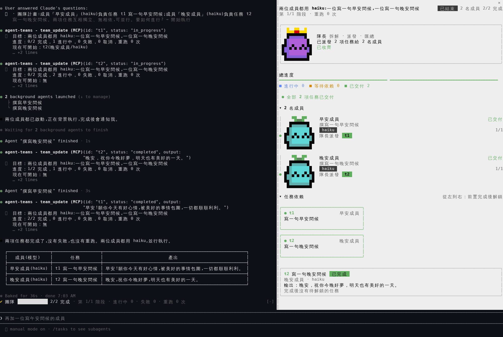

# agent-teams：隊長帶領的 agent 團隊

Claude 當隊長，把你的目標拆給幾位成員（子 agent）並行完成。右側有像素吉祥物的團隊協作面板，即時顯示進度。



## 使用方式

| 指令 | 用途 |
|---|---|
| `/agent-teams <目標>` | 組一個團隊完成目標 |
| `/agent-teams` | 打開團隊面板 |
| `/agent-team demo` | 填入示範團隊，先看面板長什麼樣子 |
| `/agent-team clear` | 清空面板 |

`/agent-teams <目標>` 的流程：

1. 隊長規劃 2–6 位成員（每人一個模型）和任務，任務之間可以有先後順序。
2. 隊長列出計畫，問你要「開始執行」、「調整模型」或「增加步驟」。
3. 按下「開始執行」後，可以同時進行的任務會並行執行；前面的任務完成，後面的才會解鎖。失敗的任務可以重跑。
4. 全部結束後，隊長寫一份整合報告。

用 `--continue` 或 `--resume` 接續對話時，團隊和進度會跟著回來。

沒有用 `/agent-teams` 時，Claude 自己派出的子代理和建立的任務，面板一樣會顯示。

## 面板

- **標題列**：目標、狀態、成員數、完成數、第幾階段、重跑次數
- **隊長卡片**：皇冠吉祥物
- **總進度**：每個任務一段（綠＝完成、藍＝進行中、橘＝等待前置任務、紅＝失敗、灰＝未開始）
- **成員**：每人一隻吉祥物，依模型決定：sonnet 是橘色拿筆、haiku 是青色發芽、opus 和 fable 是紫色戴皇冠。下面是角色、模型和負責的任務。
- **任務依賴**：由左到右分層；最下方是目前任務的詳情，包含負責人、還在等誰、產出，以及完成後會解鎖哪些任務。

吉祥物的表情會跟著狀態變：待命是 `• •`，工作中會眨眼、左右看，完成是 `^ ^`，失敗是閉眼加一滴汗。

輸入框上方還有一條精簡的進度帶。

面板要停靠在右側，終端機需要約 110 欄寬；窄一點的話，面板會改顯示在輸入框上方。

## 安裝

**雲端和手機**：這個 repo 的 `.claude/settings.json` 已經設定好。在這個 repo 開 Claude Code 雲端工作階段，外掛會自動載入。

**你的電腦**：在 Claude Code 輸入：

```
/plugin install agent-teams --marketplace tintin0831602-create/-
```

## 顏色與 Terminal.app

文字顏色跟著 Claude Code 的主題走：淺色主題是黑字，深色主題是白字。吉祥物的顏色都事先換成 xterm 256 色裡的格子，所以在 Terminal.app（不支援全彩）上也一樣。

Terminal.app 在行與行之間會留一條縫。吉祥物的每一格會挑一個背景色把縫填起來，所以角色裡面不會出現白線或黑線。

## 修改吉祥物

三隻吉祥物共用 `tools/make_mascots.py` 裡同一個 12×12 的身體模板，用字母畫像素。改完執行：

```sh
pip install pillow
python3 tools/make_mascots.py      # 產生 hooks/mascots.ts，以及預覽圖 tools/build/family.png
```

## 檔案

- `hooks/register.tsx`：指令、團隊工具、狀態保存、面板接線
- `hooks/team.ts`：團隊邏輯：規劃驗證、相依、階段、重跑
- `hooks/board.tsx`：團隊協作面板
- `hooks/view.ts`：輸入框上方的進度帶
- `hooks/mascots.ts`：面板的吉祥物，由 `tools/make_mascots.py` 產生
- `hooks/sprites.ts`、`hooks/sprite.ts`：原本依模型區分的吉祥物，給 Raster 元件用，進度帶的測試也會用到
