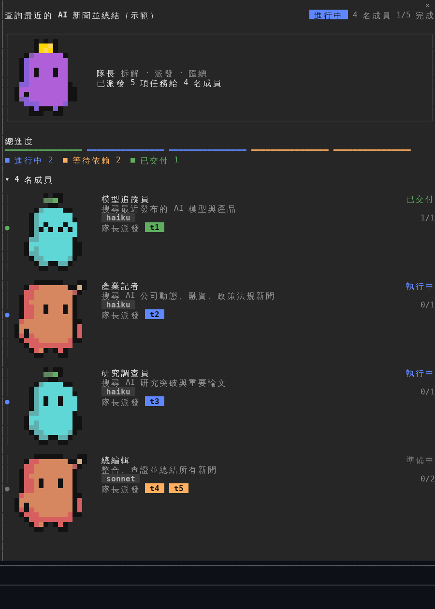

# team-board：像素吉祥物團隊協作面板

這是一個 Claude Code 的 mod。Claude 派出子代理或建立任務時，它會在右側打開「團隊協作」面板，顯示：

- 標題列：任務名稱、狀態、成員數、完成數
- 隊長卡片：皇冠吉祥物，加上「已派發 N 項任務給 M 名成員」
- 總進度：每個任務一段進度條（綠＝已交付、藍＝進行中、橘＝等待依賴、灰＝未開始）
- 成員時間軸：每位成員有頭像、名稱、角色、模型，以及任務標籤（t1、t2…）



吉祥物的表情會跟著狀態變：待命是 `• •`，工作中眼睛會左右看，完成是 `^ ^`，失敗是 `x x`。

## 使用方式

```sh
claude --plugin-dir /你的路徑/claude-mods/team-board
```

進入 Claude Code 後可以輸入：

- `/team`：打開面板
- `/team demo`：填入示範資料，不用真的派出成員就能先看效果
- `/team clear`：清空面板

面板會停靠在右側，需要終端機至少約 110 欄寬。窄一點的話，它會改顯示在輸入框上方。

## 顏色與 Terminal.app

Mac 內建的「終端機」(Terminal.app) 只支援 256 色。一般顏色在那裡會偏掉，例如橘色變粉紅、黑框變深藍。這個 mod 的所有顏色都事先換成 256 色裡最接近的那一格，所以在 Terminal.app 和支援全彩的終端機（iTerm2、Ghostty、kitty）上看起來一樣。

## 換成自己的圖

`tools/source-art/` 放著 Gemini 生成的原圖：洋紅背景，一張 5 個姿勢。重新產生角色圖：

```sh
pip install pillow numpy scipy
python3 tools/process.py 16                    # 去背、切圖、縮成 16×16，重畫表情
python3 tools/gen_ts.py hooks/sprites.ts       # 轉成 256 色相容的程式碼
```

換圖時請注意：

- 背景要用純洋紅色（#FF00FF 附近）
- 每個姿勢之間要留空白
- 第 1 張必須是正面站立、兩個方形眼睛。表情是程式根據這張重畫的。

`tools/build/shown256.png` 會顯示角色在 256 色下的實際樣子。
